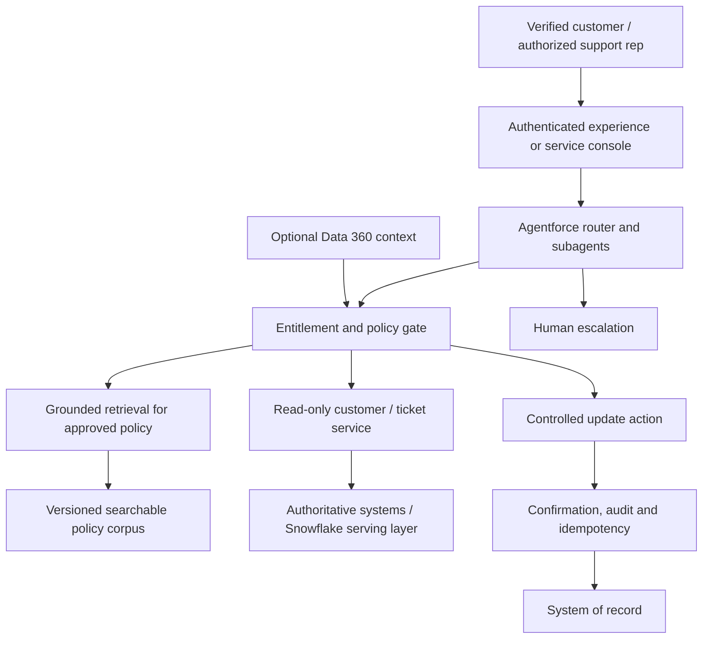

# Salesforce Data 360 + Agentforce Architecture Playbook

**A decision-first, independent learning resource for Salesforce developers, solution architects, and technical delivery professionals.**

  

> **Independence and confidentiality.** This is an independent, fictional learning project. **Aster Service Group (ASG)**, its people, data, policies, architecture decisions, numbers and example metrics are entirely invented for educational use. It does not document any real customer project, internal implementation, or proprietary design. It does not contain internal documents, identifiers, logs, customer information, credentials, or proprietary architecture. Salesforce is a trademark of Salesforce, Inc.; this project is not affiliated with or endorsed by Salesforce.

## Start here

1. Read the [learning roadmap](LEARNING-PATH.md) and choose a pathway.
2. Understand [Data 360 object modeling](docs/data-360/01-foundations-and-object-model.md) and the [architecture decision matrix](docs/enterprise-architecture/01-decision-matrix.md).
3. Follow the [Enterprise Servicing Agent case study](case-studies/enterprise-servicing-agent/README.md), starting with discovery and ending with a measurable pilot.
4. Review [Agentforce design](docs/agentforce/01-agent-architecture.md), [RAG evaluation](docs/agentforce/03-rag-evaluation.md), [security](docs/enterprise-architecture/03-security-and-governance.md), and [release management](docs/enterprise-architecture/05-devops-and-lifecycle.md).
5. Run the zero-dependency synthetic examples: `python3 labs/scripts/validate_fixture.py` and `python3 -m unittest discover -s tests -v` (Python 3.10+).
6. Open the Mermaid diagrams directly in GitHub: [architecture map](diagrams/end-to-end-architecture.md), [request flow](diagrams/servicing-agent-sequence.md), and [authorization flow](diagrams/secure-update-sequence.md).

## What this repository teaches

| Track | Learn | Practical output |
|---|---|---|
| Data 360 | Ingestion, DLO/DMO, identity, transforms, SQL, calculated insights, segmentation, zero copy | Source-to-model map and query patterns |
| Knowledge and RAG | Retrieval, indexing, chunking, hybrid/vector search, evaluation | Synthetic golden question set and scoring guide |
| Agentforce | Agent Script concepts, subagent routing, grounded answers, deterministic actions, tests | Action contract and multi-step flow design |
| Integration and trust | APIs vs CDC/events, authorization, PII, data governance, resiliency | Decision records and security checklist |
| Forward deployment | Discovery, KPI baselines, stakeholder communication, pilot rollout | Fictional case study, acceptance gates, decision log |

## Anchor case study: the Aster Service Group servicing assistant

A fictional enterprise stores customer accounts, service requests and activity in Snowflake, alongside approved policy documents, anonymized transcripts and prior-case summaries. The business wants to reduce repetitive support work and improve customer experience. We intentionally **do not assume** that moving all data to Data 360 is always correct: live APIs, selective Data 360 access and retrieval are considered separately.

**Phase-one scope:** authenticated account overview; authorized ticket status; policy and product answers with citations; safe human escalation. **Phase-two design option:** explicit-confirmation profile updates through a controlled Flow/Apex/service API (not an unbounded natural-language database write).

Read the full [case study](case-studies/enterprise-servicing-agent/README.md) or [the executive architecture summary](case-studies/enterprise-servicing-agent/02-architecture.md).

## Architecture in one glance

**Trust boundary:** authenticate the caller before retrieval/actions. Record-level authorization must run in the authoritative service or enforced data policy, not merely in an LLM prompt. For current balances/status, consider a fresh authoritative API; Data 360 ingestion is normally eventually consistent.

## Learning notes versus deployable code

- This is a **documentation-first** playbook with runnable local **fixture validation**, **SQL examples**, and **pseudo-implementations**. It is **not** a deployable Salesforce managed package or a working Agentforce agent.
- All account and case records are synthetic. The SQL examples show Snowflake-style analytics and are not promised to execute without adaptation in Data 360 Query or Calculated Insights. Object names are illustrative, not Salesforce platform metadata.
- Agent Script snippets illustrate concepts, **not** deployment-ready Agent Script syntax. Use the linked official reference when authoring in an org.
- License, feature support, consumption and release-specific behavior must be verified in the target org. See [source reference index](REFERENCES.md).

## Recommended 5-post content plan

1. Announce the decision-first playbook (after a public link exists).
2. When to use Snowflake zero-copy vs Data 360 ingestion vs live APIs.
3. Build a servicing agent with secure read and write boundaries.
4. RAG evaluation: retrieval precision/recall and groundedness.
5. Move from prototype to pilot: KPIs, observability and stakeholder alignment.

See [LinkedIn drafts](social/linkedin-series.md) and the [publication checklist](PUBLISHING-CHECKLIST.md). Do not claim an implementation was deployed or benchmarks were observed unless independently validated.

## How to contribute

See [CONTRIBUTING.md](CONTRIBUTING.md). Contributions should use synthetic records, cite official sources when feature behavior is asserted, and tag content as **conceptual**, **illustrative**, or **validated**.

## License

MIT for original educational text and code in this repository. External documentation remains owned by its respective authors. See [LICENSE](LICENSE).
