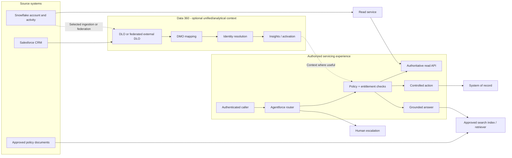

# Data 360 + servicing agent: conceptual map

**Interpretation:** dotted lines represent optional choices; these are not automatic native connectors or guarantees of zero-copy availability. Data authorization and consent are enforced before exposing data to the agent.
