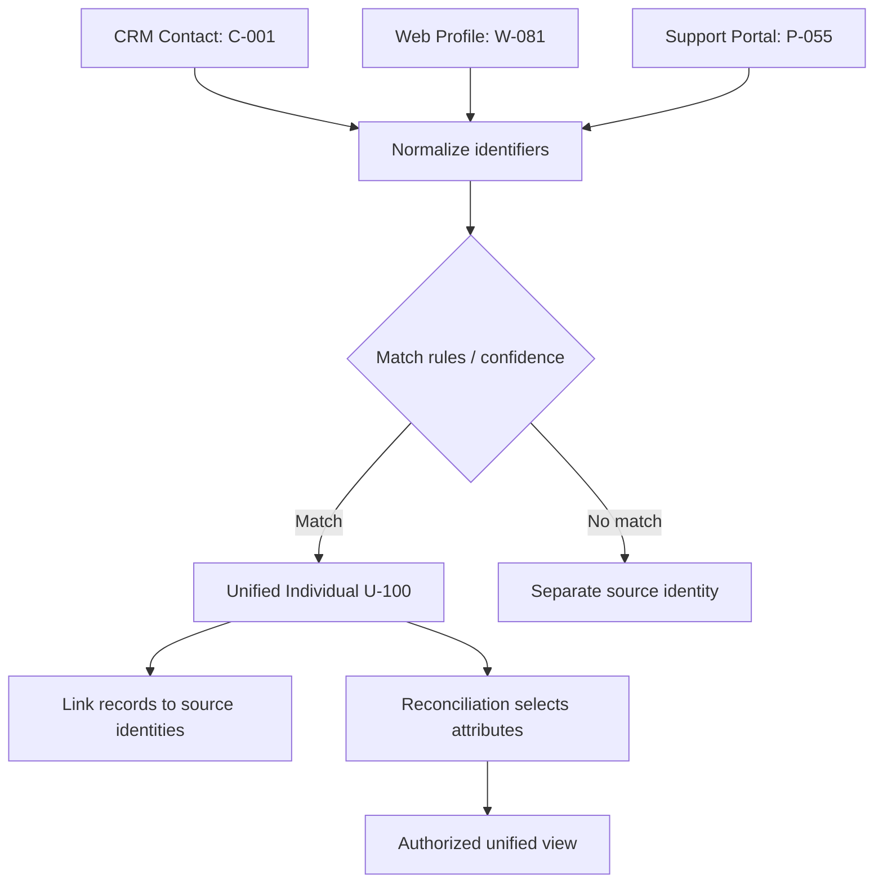

# Identity resolution: match and reconciliation

Unified identity does **not** delete or merge the original source records. A matched identity is not itself an authorization entitlement; access must be checked separately.
